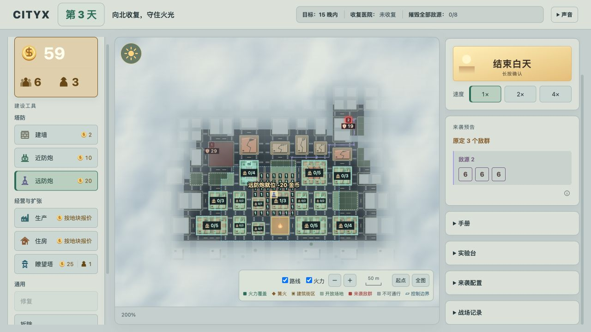
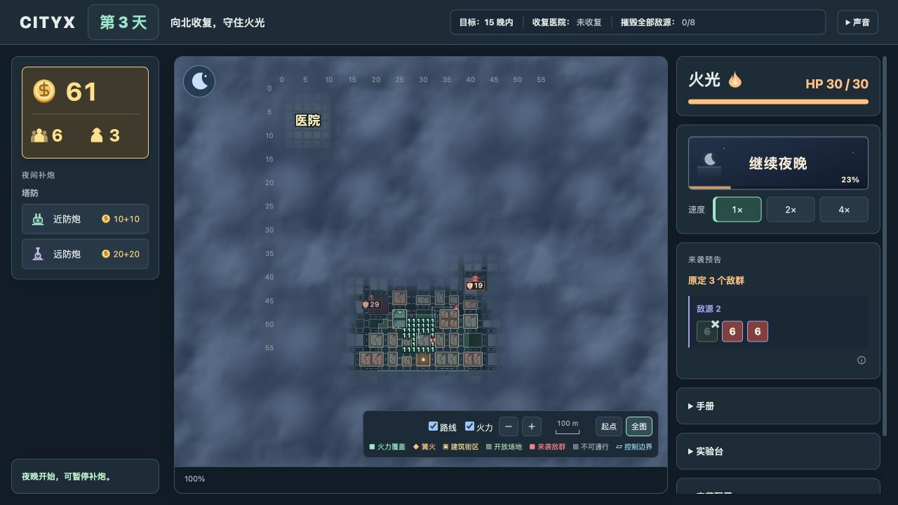

# 第三次试玩反馈 · 2026-10-10

试玩日期：2026-10-10，按用户指定日期记录。整理与画面复查：2026-10-12。

来源：用户报告第三次试玩的问题，并与助手讨论改进方向。以下区分试玩反馈、当前版本复查、用户确定方向与助手建议；本文记录分析，不表示建议已经实现。

## 试玩反馈

用户报告：**地图信息太多，可视性和可读性太差，包括边界看不清。**

助手判断：地图的信息层级不明确，装饰、权限、操作预览和精确数值以接近的视觉权重同时出现。玩家需要先辨认线、框、颜色和数字，才能判断哪里属于自己、哪里可以建设、哪里需要防守。这会增加操作成本，也会削弱收复城市的成果感。

## 用户确定的本轮方向

1. **增强控制线的视觉权重**，让玩家明显看出哪里属于自己。
2. **优化火力数字的展示**，避免大量逐格数字长期占据地图。
3. **让缩放同时调整信息密度**，不再只改变所有内容的大小。
4. **缩放与比例尺移到地图框的固定底栏**；完整图例收进 ⓘ 或已有手册，减少战场内的控件遮挡。

用户补充：**原型也需要考虑正式版的视觉效果，本轮先保留道路与建筑装饰线，不优先通过减弱这些装饰来解决可读性。** 改进应先从控制边界、信息叠加、缩放展示和控件布局入手。

以上确认的是改进方向。控制线具体样式、各缩放级别的显示阈值、容量与报价的筛选方式仍需确定；不能把助手建议全部视作已授权实施。

## 当前版本复查

助手查看了初始白天、建炮、生产建设、右键取消后的浏览状态，以及少量设施下的第三晚；同时比较全图和近距离缩放，并核对绘制逻辑。

复查结果来自2026-10-12当时的工作区原型，包含正在迭代的视野表现，**不是2026-10-10试玩现场的测量或录像**。尚未确认第三次试玩的具体日数、设施数量和窗口大小；中后期更拥挤是推断，不写成已观察事实。

| 复查场景 | 实际观察 |
| --- | --- |
| 起点视角 | 在1280×720窗口中，显示200%时一格仍仅约13.5px；缩放百分比相对全图适配尺寸计算。 |
| 控制边界 | 控制线按格子缩放，当前约1.1px，细密短虚线与道路标记、建筑框线混在一起。 |
| 建炮模式 | 可建炮位逐格高亮、每栋军事容量、火力数字、路线和建筑轮廓同时出现。 |
| 一门远防炮建成后 | 已出现大片重复的逐格火力数字；右键取消工具后，开启的火力层仍然保留。 |
| 生产建设 | 多栋地块同时显示成本、用工、收益；小地块为容纳多行报价而缩小文字，内容完整但难读。 |
| 第三晚的小规模夜战 | 敌人基本可以辨认，控制线仍夹在道路标线、建筑边框和火力数字之间。 |
| 全图视角 | 火力数字挤成密集的一团，战术细节没有随缩放退出；战略轮廓和推进方向不够突出。 |
| 放大至约313% | 右下角地图控件盖住了篝火区域。 |

### 复查画面

建炮模式：只有一门远防炮，炮位、容量、逐格火力和场景细节已经同时争抢注意力。下图为2026-10-12复查截图。

全图视角：火力数字仍然保留，挤占了战略阅读空间。下图为2026-10-12复查截图。

## 完整问题分析

### 1. 控制边界缺少清楚的视觉归属

控制线、道路虚线、空地虚线、建筑边框和炮位小格框的线宽、节奏相近，玩家难以连续追踪领地外轮廓。控制线随世界格子一起缩小，远景下尤其不清楚。

**助手建议：**采用更明确的连续轮廓、深色衬线和最低屏幕像素宽度；辅以稳定而轻微的受控地面明暗区别，让玩家先识别整片领地，再读取精确边缘。先提高控制线的视觉权重，保留用户要求的道路与建筑装饰。

展示须保持现有规则：常驻边界依据最终建筑整体归属绘制；选墙或瞭望塔时，合法位置仍依据基础地面控制判断。不要长期同时显示两套控制边界。控制区表达建设与经营权限，不能让玩家误以为其中敌人无法进入。

### 2. 火力数字容易大量重复

一门远防炮有7×7射程，逐格数值展示会迅速形成大片重复标记；叠加炮塔后，数字及其深色底板持续占据道路和建筑附近。右键取消没有撤下开启的火力层，浏览状态仍然像计算图。

**助手建议：**按当前任务展示信息。平时浏览和观看夜战侧重设施、敌人及攻击结果；布置炮塔时显示当前炮的射程、覆盖道路和局部火力变化；精确火力可通过悬停某格或主动开启完整分析层查看。保留精确布防能力，不把读懂战场的责任全部交给玩家手动关开关。

火力覆盖和可建炮位目前都偏绿色，应通过形状、边线或不同表现方式区分，避免同色被理解为同一含义。

### 3. 建设模式同时承担过多比较任务

选炮后每栋显示军事容量、每个合法炮位单独框选；选生产后多栋同时显示成本、用工和收益。单项都有用途，但一起出现时，建筑变成许多小信息卡的底图。小地块内自动缩小文字只能保证放得下，不能保证读得懂。

**助手建议，尚未单独确认：**保留费用比较，细则在关注某栋建筑后补充；军事容量在近距离可以整体显示，远景优先当前关注对象。此项会修订此前“选炮时每栋受控建筑都显示容量”的展示要求，实施前须确定筛选方式。

### 4. 场景细节与战术标记争抢注意力

道路的路缘、中线和斑马线，建筑的内外框、屋顶线及裂纹，在缩小时集中成密集亮点；工具格网和战术标记进一步叠加。完好生产与绿色空地也需要更清楚的辨识依据。

原分析曾建议降低装饰线存在感。**用户本轮不采用先减弱道路、建筑装饰线的方案。** 保留这项问题诊断，先通过战术层的权重、出现条件和缩放展示改善阅读；建筑大轮廓、用途与恢复状态的进一步区分仍是候选，未作为本轮实施要求。

### 5. 缩放缺少信息层级切换

远景仍保留逐格火力等近景信息，部分标记又以最小字号兜底，造成标记相对地块更显眼。只把地图放大不能解决全图阅读问题，也可能把重要目标推出视野。

**助手建议：**以实际每格屏幕像素判断展示密度，而非只看缩放百分比。全图强调控制区、篝火、医院、敌源和进攻方向；常用视角显示建筑状态、设施及当前任务提示；近景再提供精确格子、容量、火力和详细报价。缩放优先管理战术信息，不把削弱场景装饰作为本轮前提。

起点镜头是否进一步靠近是候选，需要同时检查篝火、主要来袭方向与建设空间能否保持在视野内；具体阈值未定。

### 6. 有效操作区局部拥挤，外围却较空

侧栏占据横向空间，地图内又有大面积云雾，实际建设和防守集中在较小城区。玩家会同时感到外围很空、城区很挤。

**助手建议：**用清楚的控制边界和信息层级缓解局部拥挤。玩家应容易区分“已经控制”“看得见但尚未控制”“尚未看清”。S0–S3是实现中的雾层划分，不必让玩家额外学习多条边界；雾散去也不能被误读为已取得控制。重做侧栏布局或扩大地图暂未确定。

### 7. 地图控件遮挡实际战场

右下栏同时放置路线/火力开关、缩放、比例尺、视角按钮和完整图例，覆盖面积偏大。近距离观察时已出现篝火被盖住的情况。

**用户确认方向：**缩放与比例尺放到地图框固定底栏，完整图例收进ⓘ或已有手册。底栏属于界面区域，不应继续覆盖可交互的地图；其他控件的具体排布在实施时确定，日夜沿用同一布局。

### 8. 城市收复成果不够直观

收复和经营带来的反馈容易被小图标、数字及新增边框淹没，整片城区归属与恢复的持续变化较弱。

**助手判断：**清楚的领地轮廓和可辨认的恢复状态，可以让玩家直接看见“原来只能看见的城区，现在成为我能使用的城市空间”。这服务于城市收复的核心体验，不等于已经验证经营或扩张机制好玩。本轮先落实用户选定的四个方向，恢复状态的更多表现留待复审。

## 信息展示分工建议

下表用于进一步讨论，不是已经确定的全部显示规则。

| 当前任务 | 地图优先显示 | 关注对象后补充 |
| --- | --- | --- |
| 浏览城市 | 控制边界、建筑状态、设施、敌源 | 当前对象的简短详情 |
| 建炮 | 合法炮位、已有炮、当前预览射程 | 所在建筑容量、局部火力 |
| 恢复生产／住房 | 可操作地块、建设费用 | 用工、收益或新增人口 |
| 夜战 | 敌人、攻击反馈、受损墙、关键路线 | 精确生命和火力信息 |

关键路线仍须帮助白天布防、夜间追踪进攻；已有敌源与路线的来源颜色和联动关系保留讨论基础，不因信息减量自动隐藏必要威胁。

## 下一轮建议与验收

建议顺序：增强控制边界 → 整理火力数字出现条件 → 按缩放管理战术信息 → 移出遮挡战场的控件。保持道路与建筑装饰；不借本轮增加入口占领、复杂安全区或新的战斗规则。可配置参数继续同步config、实验台、校验和展示。

下一次真人试玩可不给口头提示，让玩家完成以下阅读与操作：

1. 在白天、夜晚和不同缩放下，指出当前受控范围，并辨认边界建筑是否整栋归属。
2. 找到一个合法炮位；在边界建筑远侧分别判断炮、墙和瞭望塔是否可建，确认视觉与权限一致。
3. 布置炮塔后右键退出，能继续轻松辨认道路、设施与进攻方向；需要时仍能查看精确火力。
4. 缩到全图能读出篝火、医院、已知敌源及城市推进方向，细碎数字不挤成一团；放大后信息恢复。
5. 比较生产地块时能读取费用，关注某栋后能看懂用工与收益；不会因过小文字误判。
6. 近距离观察篝火和夜战时，固定控件不遮挡目标或可操作地块；日夜布局一致。
7. 玩家能解释新收复的一片城区在哪里，以及因此获得了什么可使用空间。

观察玩家是否需要反复缩放、寻找边界、逐项关闭叠加层，或依赖开发者解释。技术检查和画面复查只能确认展示行为；改动是否改善决策与收复感，需要再次真人试玩。

当前规则入口：[GDD](GDD.md)、[视野与迷雾](vision.md)、[建筑炮位与经营](plot-economy-and-outposts.md)。

## 2026-10-12 跟进：先增强控制边界

- 用户要求先实现控制线和边界增强，继续保留道路与建筑装饰。
- 当前已接入连续蓝色轮廓、深色衬边和只落在受控侧的轻微色带；主线2.2–3屏幕像素，近景与全图都保留可见宽度，昼夜共用几何并平滑调整颜色。
- 轮廓仍依据最终控制mask，建筑整栋归属、地面逐格控制、墙/瞭望塔权限和视野均保持原规则；色带不向外扩张权限、不阻挡敌人。路径缓存随状态更新，镜头操作复用。
- 该轮只处理第一项。表现是否让玩家更容易认出自己的领地，仍须真人试玩复审。

## 2026-10-12 跟进：路线火力与缩放密度

用户确认保留夜间精确伤害判断，同时收敛全图重复数字：

- 地图“火力”默认开启，数字限于当前预告的有效路线；夜间包含待出场及在场敌人的剩余路线，不限于移动中的敌人，墙前停留格仍相关。休眠敌源的潜在路线不常驻数字。
- 常用/近景保留非零逐格数字，每格不足默认12屏幕像素时隐藏；远景仍有路线和覆盖。阈值同步config、实验台与整数校验，可设0取消门槛。
- 建炮保留射程轮廓及覆盖到的路线格高亮，只在这些格预览叠加火力；关闭普通火力也能预览，远景服从数字门槛。建筑屋顶、墙和敌源占地不铺数字。
- 可见敌人的身体格优先HP，移动插值时避让数字；实际受击/伤害反馈保留。迷雾权限不变，隐藏敌人不通过数字避让暴露位置。
- 全图逐格数字进入实验台，默认关闭，供开发检查；主动开启可越过缩放门槛，仍限于可见可通行射程格。
- 后续确认并实现：预览敌源路线时同步显示关联火力，普通火力关闭也临时显示；开启时其他路线数字保持原样，关联文字轻微提亮，字号/位置不变。休眠已知源头潜在路线也可预览当前火力，共用格不重复数字；移开/失焦恢复，缩放与迷雾限制不变，不新增整路总伤害。
- 每拍结算不变，停留在墙前仍持续受伤；大型敌源仍只有共享HP与单一受击值。暂不合并连续同火力路段数字。

本轮落地火力层的缩放筛选；军事容量、经营报价等其他信息密度和固定底栏尚未改动。改进是否降低玩家阅读负担仍须真人试玩。

### 追加：固定敌源路线查看（2026-10-12，用户确定）

- 点击地图敌源或预告行固定路线与火力，图钉标记；再点同一源取消、点另一源切换，右键或浏览状态点空白解除。选工具、沿途建设与镜头操作保留，悬停另一源额外临时预览。
- 休眠敌源潜在路线也可固定，用于提前规划炮位与扩张；建炮叠加预览包含该路线。潜在走法随实际建筑建拆更新，墙不引导绕路，不承诺未来攻击路线或揭示未来计划。
- 正常次日保留源头选择并显示当晚路线/潜在方向，摧毁或重开解除；迷雾、缩放门槛、HP优先与其他数字保留规则继续适用。
